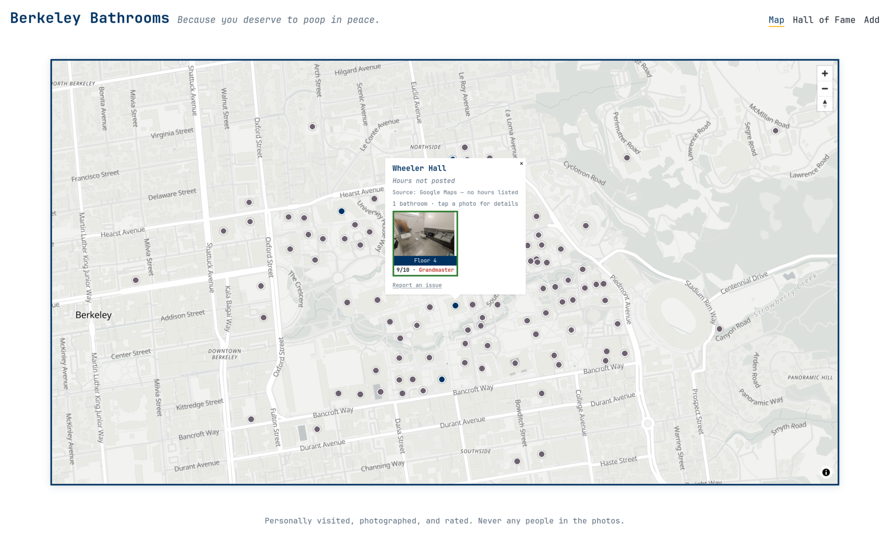
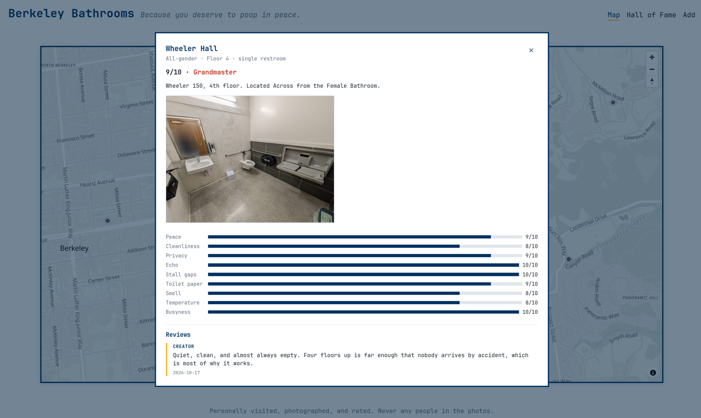
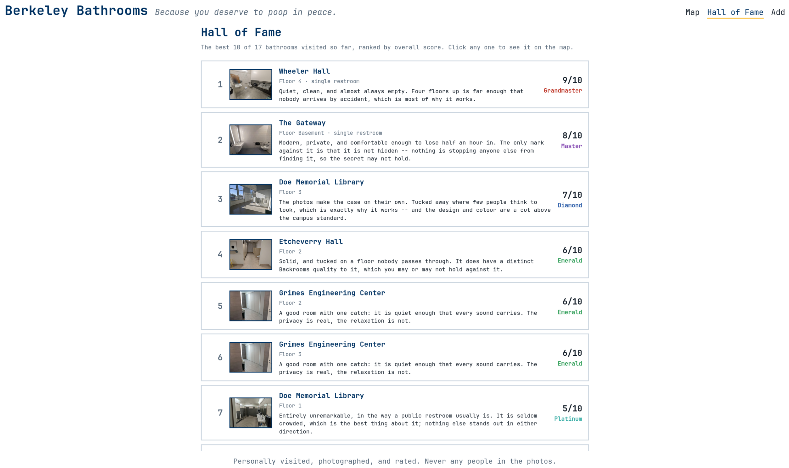

# Berkeley Bathrooms

**Because you deserve to poop in peace.**

A map of UC Berkeley bathrooms — each one visited, photographed and rated
across nine categories. Work in progress :3

> Built from my own ideas and my own visits, with
> [Claude Code](https://claude.com/claude-code) as a pair programmer for the
> code itself. The bathrooms, the ratings and the opinions are mine.

---

## Examples

**The map.** One dot per building — blue where there's a bathroom logged, grey
where there isn't yet. Click a dot for hours and photos.



**A bathroom.** Click any photo for the full detail: all nine ratings, the
score, the tier and a review.



**Hall of Fame.** Everything ranked, best first. There's a Hall of Shame too.



---

## How you can help

No account needed beyond a free GitHub one. Both of these take about a minute.

### Send a bathroom photo

1. Open a [new issue](https://github.com/grish11/berkeley-bathrooms/issues/new).
2. **Drag your photo straight into the text box** — GitHub uploads it for you.
3. Say which **building** and **floor** it's in, and how to find it.

That's it. I'll rate it and add it to the map.

**One rule: no people in the photo.** Not in the background, not reflected in a
mirror, not feet under a stall door. I'll also strip the location data out of
every photo before it goes on the site.

### Add or fix a building's hours

Most buildings on the map have no hours yet. If you know some:

1. Click **Report an issue** in that building's popup on the map — it opens an
   issue with the building already filled in.
2. Write the hours, e.g. `Mon–Fri 8am–10pm, Sat–Sun 10am–6pm`.
3. Say **where you found them** — a campus page, a door sign, or just "I'm
   there every day."

Knowing the source matters, because when hours turn out to be wrong that's the
first thing I need to check.

---

## Ratings

Nine categories, each **1–10, where 10 is always best**:

> Peace · Cleanliness · Privacy · Echo · Stall gaps · Toilet paper · Smell ·
> Temperature · Busyness

So 10 Echo means *silent*, and 10 Busyness means *empty*.

The average becomes a tier: **Iron, Bronze, Silver, Gold, Platinum, Emerald,
Diamond, Master, Grandmaster, Challenger.**

---

## Coming later

- Open / closed right now, from each building's weekly schedule, along with a visual representation of this
- Anyone can sign in with a `@berkeley.edu` address, to be able to leave comments and have access
- Community ratings that count toward the overall score, like Google Reviews
- Comments on bathrooms, with moderation, from people that have access
- Filters: single restrooms only, open now, minimum tier
- A "find me peace **now**" button using your location?!?? maybe..

---

## Built with

| | |
|---|---|
| **Python + [Flask](https://flask.palletsprojects.com)** | the server |
| **[Jinja](https://jinja.palletsprojects.com)** | HTML templates |
| **[MapLibre GL JS](https://maplibre.org/maplibre-gl-js/docs/)** | the map |
| **[OpenFreeMap](https://openfreemap.org/)** | map tiles, no API key needed |
| **[Pillow](https://pillow.readthedocs.io)** | resizes photos, strips location data |
| **JSON files** | the data. No database yet. |

---

## Running it yourself

```bash
uv sync
uv run flask --app app run --debug
```

Then open <http://127.0.0.1:5000>.

More detail: [how the code fits together](docs/ARCHITECTURE.md) ·
[adding bathrooms](docs/ADDING_BATHROOMS.md) ·
[the data format](docs/DATA_FORMAT.md)
